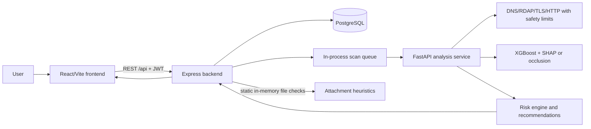
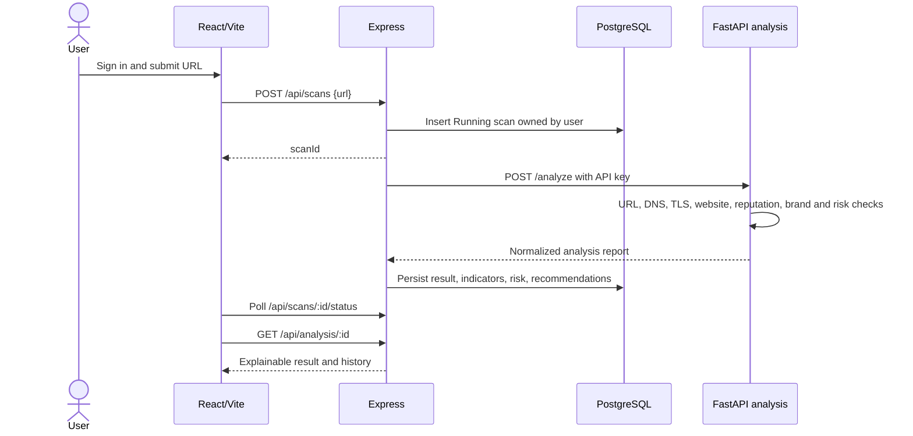
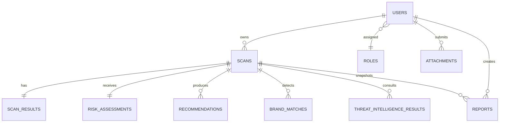

# PhishGuard — Phishing Attack Detection and Risk Assessment System

PhishGuard is a college-project web application for analysing suspicious URLs and files. It combines URL heuristics, domain/DNS and TLS observations, static website inspection, homograph and brand-impersonation checks, internal threat indicators, and an optional machine-learning prediction into an explainable risk assessment.

> **Important:** A low score or an `Unknown` reputation does not prove that a URL or file is safe. The system is an analysis aid, not a guarantee or a replacement for security review. Network checks can be unavailable, external feeds are not configured in this repository, and the supplied model is trained on synthetic data.

## Contents

- [1. Overview](#1-overview)
- [2. Abstract](#2-abstract)
- [3. Problem and proposed system](#3-problem-and-proposed-system)
- [4. Implemented modules](#4-implemented-modules)
- [5. Technology stack](#5-technology-stack)
- [6. Architecture](#6-architecture)
- [7. Repository structure](#7-repository-structure)
- [8. Setup](#8-setup)
- [9. Application workflow](#9-application-workflow)
- [10. URL-analysis concepts](#10-url-analysis-concepts)
- [11. Machine learning](#11-machine-learning)
- [12. Risk scoring](#12-risk-scoring)
- [13. API reference](#13-api-reference)
- [14. Database design](#14-database-design)
- [15. Security and privacy](#15-security-and-privacy)
- [16. Testing and validation](#16-testing-and-validation)
- [17. Troubleshooting](#17-troubleshooting)
- [18. Limitations and future work](#18-limitations-and-future-work)
- [19. Viva and placement preparation](#19-viva-and-placement-preparation)
- [20. Resume description](#20-resume-description)
- [21. Glossary](#21-glossary)
- [22. References](#22-references)

## 1. Overview

### Problem statement

Phishing messages often use look-alike domains, misleading paths, redirects, copied login pages, and urgent language. Manual inspection is slow and depends on a person noticing several weak signals at once. A single blacklist lookup also misses newly created sites and cannot explain why a result was produced.

### Objectives

- Accept and validate URLs for asynchronous analysis.
- Preserve scan history and reports per authenticated user.
- Combine deterministic indicators with an optional ML prediction.
- Show evidence, risk level, contributing factors, and recommendations.
- Provide static file checks without executing or storing uploaded files.
- Give administrators controlled access to users, scans, audit logs, and internal indicators.

### Why this is risk assessment

The result is not only `Phishing` or `Legitimate`. The system records a score from 0–100, a level, a category, evidence from several modules, mitigating factors, module status, recommendations, reputation results, and—when available—model probability and explanations. Missing or unavailable evidence is represented as unavailable rather than silently treated as proof of safety.

### Current feature status

| Area | Implemented behavior |
|---|---|
| URL scans | Queued scan records, status polling, cancellation, history, detail and deletion |
| URL analysis | URL structure, DNS/RDAP when enabled, TLS, redirects, static HTML/scripts, homographs, typosquatting and brand checks |
| ML | XGBoost model loading and `/predict`; full `/analyze` can blend ML with heuristics |
| Threat intelligence | Internal blocklist and lookup; provider/feed records exist, but external feed synchronization is intentionally unavailable |
| Attachments | In-memory, static extension/MIME/name heuristics and SHA-256; no execution or storage of file bytes |
| Reports | Persisted report snapshots with JSON and CSV download support; no evidence here of a generated server-side PDF |
| Admin | Role/permission-protected dashboard operations and audit log access |
| Frontend demo mode | Available with `VITE_USE_MOCK=true`; it uses local mock data and is not the live backend |

## 2. Abstract

PhishGuard is a modular phishing risk-assessment system built with a React/Vite client, an Express API, PostgreSQL persistence, and an optional FastAPI analysis service. A user submits a URL, after which the backend creates a scan and processes it through a bounded job queue. The analysis service parses the URL, performs safe network and static-page checks subject to timeouts, evaluates domain and certificate signals, checks internal reputation data, detects look-alike domains and brand impersonation, and optionally invokes an XGBoost model. A transparent additive risk engine combines evidence into a bounded score and recommendations. Results are mapped into PostgreSQL tables and exposed through authenticated APIs for history and report generation. The project also includes static attachment analysis, role-based administration, audit logging, rate limiting, and cross-user access checks. The provided model and sample data are synthetic; therefore the project demonstrates an engineering pipeline and explainability approach, not validated real-world detection performance.

## 3. Problem and proposed system

Traditional manual review or a single-signal classifier may miss a new domain, over-trust HTTPS, or provide no useful explanation. PhishGuard uses independent signals and records their availability. For example, an IP-based host, an external password-form action, a suspicious redirect, a newly registered domain, and a look-alike brand may reinforce one another; a valid certificate can reduce uncertainty but does not cancel hard evidence.

The system does not claim superiority over commercial products. It is a reviewable academic implementation whose major design decision is traceability: every score contribution has a named factor and source module.

## 4. Implemented modules

### Authentication and authorization

`POST /api/auth/register` creates an account, `POST /api/auth/login` returns a JWT, and `/me`, logout, logout-all, profile, and password-change endpoints manage the session. Passwords are hashed with `bcryptjs`. JWT verification rechecks the account, token revocation, token version, expiry, and suspension status on every request. Login attempts and registrations are rate-limited; failed logins also have an account lockout path in `authService.js`.

Roles are `super_admin`, `admin`, `analyst`, and `user`. Admin routes require `admin` or `super_admin`; individual permissions control user, scan, log, and threat operations. Analysts are defined in the RBAC table but do not receive admin access in the current middleware.

### URL submission and scan lifecycle

The backend validates the URL, creates a `Running` scan, returns a public scan identifier, and places analysis on a bounded in-process queue. A configured analysis service is called with an API key and timeout. If no service URL is configured, the built-in mock analyzer is allowed in development (and must be explicitly allowed in production). Results are mapped into the one-to-one analysis tables, recommendations are persisted, and the scan becomes `Completed`; failures become `Failed`. The stale-running setting is used by recovery/cleanup logic. Users can poll status, cancel/delete their own scans, and read only accessible scans.

### Analysis engines

The Python engine implements:

- lexical URL checks: length, special characters, encoding, IP hosts, ports, shorteners, risky TLDs, keywords, path/query structure and executable paths;
- domain/DNS and RDAP registration observations, including age, nameservers and resolution;
- TLS certificate validity, hostname matching, trust, version and selected certificate properties;
- safe redirects and static HTML inspection; JavaScript is parsed as text and never executed;
- forms, external form actions, iframes, hidden elements, suspicious script patterns, downloads and client-side redirects;
- IDN/homograph and typosquatting signals;
- configured brand data from `analysis/data/brands.json` and similarity signals;
- internal blocklist and DNSBL-style reputation observations when configured.

Each module returns status, duration, evidence, and—when applicable—an error or reason such as `network_disabled`, `timeout`, `dns_failure`, `host_is_ip_address`, or `not_requested`. A missing reputation is `Unknown`, not `Clean`.

### Machine learning

The Python service exposes `/predict` for model inference and `/analyze` for the complete engine. The checked-in model bundle identifies XGBoost and includes URL-derived features plus optional security features. SHAP TreeExplainer is preferred; occlusion is the fallback when SHAP is unavailable. Probability means the model's estimated `P(phishing)` and confidence is a heuristic reliability indicator, not a calibrated confidence interval.

### Threat intelligence

The database supports indicators for URLs, domains, IPs and hashes, provider results, and feed metadata. Lookup returns `Malicious`, `Suspicious`, `Clean`, or `Unknown` according to the internal data. The service explicitly refuses to enable or synchronize feeds because no external integration is configured. Names shown in frontend demo data must not be presented as active live feeds.

### Attachments

`POST /api/attachments` accepts one multipart field named `file`, up to `MAX_UPLOAD_MB` (25 by default). Multer keeps bytes in memory. The backend calculates SHA-256, checks a supported extension, compares the reported MIME type, detects double extensions, right-to-left override characters, suspicious names and risky file types, and stores metadata/result—not the file bytes. The result is static heuristic analysis, not malware execution or a claim that “no malicious reports found” proves safety.

Supported extensions are defined in `backend/src/services/fileHeuristics.js`, including common documents, archives, images, HTML, scripts, Windows executables/installers, Java archives, and disk images.

### Reports

Users can create a report snapshot for an accessible completed scan. The backend stores report metadata and JSON data, then serves JSON or CSV downloads through `/api/reports/:id/download?format=json|csv`. Access is checked against the report owner. Frontend mock PDF helpers are demo-only and do not establish a live server PDF feature.

## 5. Technology stack

| Technology | Location | Purpose |
|---|---|---|
| React 18, React Router 6 | `phishguard-frontend` | Single-page UI and protected routes |
| Vite 5, JavaScript, JSX, CSS | `phishguard-frontend` | Development server and production build |
| Bootstrap 5, Recharts | frontend | Layout/components and charts |
| Axios | frontend | API calls, JWT header and error handling |
| Node.js >=18.11 | backend | API runtime |
| Express 4 | backend | HTTP routes and middleware |
| PostgreSQL, `pg` 8 | backend | Relational persistence and transactions |
| Zod | backend | Request validation |
| JWT, bcryptjs | backend | Sessions and password hashing |
| Helmet, CORS, Morgan, express-rate-limit | backend | HTTP hardening, origin policy, logging and throttling |
| Multer | backend | In-memory multipart uploads |
| Python, FastAPI, Uvicorn | `ml-service` | Analysis and model HTTP service |
| NumPy, pandas, scikit-learn, XGBoost | ml-service | Features, preprocessing, model training/inference |
| SHAP, joblib | ml-service | Explainability and optional sklearn model persistence |
| `unittest`-style Python tests and Node test runner | tests | Automated validation |

Exact installed Python versions are recorded in the checked-in model metadata; they should not be treated as a universal environment specification. Install from `ml-service/requirements.txt` and `requirements-dev.txt`.

## 6. Architecture



The frontend defaults to `/api` and can use `VITE_API_URL`. The backend defaults to port 5000. The FastAPI service is normally run on port 8000. A Vite development server commonly uses port 3000 in this project setup; verify the actual Vite output if the port is occupied.

## 7. Repository structure

```text
phishguard-fullstack/
├─ backend/
│  ├─ src/controllers/       HTTP handlers
│  ├─ src/routes/            /api route definitions
│  ├─ src/services/          scans, analysis, reports, threats, files, auth
│  ├─ src/models/            PostgreSQL access
│  ├─ src/db/migrations/     ordered SQL migrations 001–006
│  ├─ src/middleware/        auth, RBAC, validation, upload, limits
│  └─ tests/                 API, flow and unit tests
├─ ml-service/
│  ├─ app/                   FastAPI and model loading
│  ├─ analysis/              full security analysis and risk engine
│  ├─ features/              feature extraction/schema
│  ├─ preprocessing/         training preprocessing
│  ├─ training/              sample generation, split, train, evaluate
│  ├─ explainability/        SHAP/occlusion explanations
│  ├─ models/                checked-in model bundle and metadata
│  └─ tests/                 Python analysis tests
└─ phishguard-frontend/
   ├─ src/api/               live and mock API clients
   ├─ src/pages/             user, report, attachment and admin screens
   ├─ src/auth/              session and frontend RBAC
   └─ src/components/        layout and reusable UI
```

Generated dependencies, Python caches, build output, and `backend/.env` are intentionally omitted.

## 8. Setup

### Backend and PostgreSQL

Use a PostgreSQL database and copy the example configuration. Do not copy real credentials into documentation or source control.

```powershell
cd C:\Users\vaish\OneDrive\Documents\phishguard-fullstack\backend
Copy-Item .env.example .env
npm install
npm run db:migrate
npm run db:seed       # optional development seed; requires the SEED_* values
npm run dev
```

The backend reads `DATABASE_URL`, `JWT_SECRET` (at least 32 characters), `PORT`, `CORS_ORIGIN`, rate-limit settings, upload settings, and `ANALYSIS_*` settings. `TEST_DATABASE_URL` must point to a disposable database whose name contains `test`; the test setup can wipe it. See [backend/.env.example](backend/.env.example), not `.env`, for names and placeholder values.

### Python analysis service

```powershell
cd C:\Users\vaish\OneDrive\Documents\phishguard-fullstack\ml-service
py -m venv .venv
.\.venv\Scripts\Activate.ps1
python -m pip install -r requirements.txt
python -m pip install -r requirements-dev.txt
$env:ML_API_KEY = '<same placeholder value configured as ANALYSIS_API_KEY>'
python -m uvicorn app.main:app --host 127.0.0.1 --port 8000
```

Set the backend `ANALYSIS_SERVICE_URL=http://127.0.0.1:8000` and `ANALYSIS_API_KEY` to the same secret as `ML_API_KEY`. If the model files fail checksum or are missing, `/health` reports degraded and `/analyze` cannot include ML. The service can still be started for health diagnostics.

The service also reads analysis settings such as `ANALYSIS_ENABLE_NETWORK`, `ANALYSIS_ALLOW_PRIVATE`, `HTTP_TIMEOUT`, `ANALYSIS_TOTAL_TIMEOUT`, `RDAP_ENABLED`, `BLOCKLIST_PATH`, `RISK_ML_WEIGHT`, and `ANALYSIS_MAX_CONCURRENT`; inspect `ml-service/analysis/config.py` for defaults.

### Frontend

```powershell
cd C:\Users\vaish\OneDrive\Documents\phishguard-fullstack\phishguard-frontend
npm install
npm run dev
```

For the live backend, leave `VITE_USE_MOCK` unset/false and set `VITE_API_URL` if the API is not reachable at `/api`. For a UI-only demonstration, set `VITE_USE_MOCK=true`; mock users, reports, threat feeds, and attachment results are not backend evidence.

## 9. Application workflow



If the external analysis service is absent in development, the backend's mock analyzer supplies a development result. If a configured service times out or fails, the scan is failed/partial according to the backend path and the UI should communicate that some checks were unavailable.

## 10. URL-analysis concepts

| Concept | What the implementation checks | What it cannot prove |
|---|---|---|
| Parsing/normalization | HTTP(S) URL structure, host, registered domain, path, query and port | That the destination is trustworthy |
| Lexical heuristics | Length, encoding, `@`, IP hosts, keywords, risky TLDs, shorteners, entropy and unusual paths | That every unusual URL is malicious |
| DNS/domain | Resolution, nameservers, registration/RDAP details, age and local reputation | Ownership intent or future behavior |
| TLS | HTTPS, certificate validity, hostname match, trust and selected TLS properties | That HTTPS content is legitimate; phishing sites can use valid certificates |
| Redirects | Chain length, cross-domain hops and final host | Safety of the final page if it changes later |
| Homographs | Mixed scripts, invisible controls, IDN/punycode and confusable labels | Human intent; a legitimate internationalized domain may look unusual |
| Brand impersonation | Known brand data and similarity/typosquatting signals | Trademark ownership or a definitive phishing verdict |
| Website inspection | Static HTML forms, external actions, iframes, hidden elements, scripts, downloads and redirects | Dynamic behavior; JavaScript is not executed |
| Threat intelligence | Internal indicators, provider-shaped results and `Unknown` states | Freshness or complete coverage without configured external feeds |
| Timeouts/private targets | Network safety, public-address checks, size/redirect/time limits | A safe verdict when a module was skipped or failed |

Example: `https://secure-paypa1.example/login` may produce a look-alike/brand signal and a login-form signal. That is evidence for caution, not proof by itself. Conversely, `https://real.example` can still be compromised even if no current indicator is found.

## 11. Machine learning

The serving pipeline extracts URL features from `features/schema.py` and can accept optional security features such as domain age, DNS resolution, TLS validity, redirect count, login/password fields, external form action, iframe count, suspicious scripts, and threat-feed hits. Missing values remain missing where the model supports them. The checked-in model is an XGBoost bundle loaded from `ml-service/models`, with a recorded checksum and metadata.

`POST /predict` returns `prediction`, `probability`, `confidence`, top feature contributions, text explanations, model version, and explanation method. The decision threshold comes from model metadata (the serving default is 0.5). `confidence` is explicitly a boundary-distance/coverage heuristic, not a statistical confidence interval. `/analyze` invokes the complete engine and includes ML when a model is loaded and requested.

SHAP TreeExplainer is used for XGBoost when available. The fallback is feature occlusion against training medians. Positive log-odds contribution pushes toward phishing; negative contribution pushes toward legitimate.

The training/data documentation describes synthetic sample generation and recommends replacing it with licensed, labelled real URLs. Any metrics in `models/metrics.json` describe that dataset and split only. They must not be presented as real-world accuracy, and this README intentionally does not claim production performance.

## 12. Risk scoring

The authoritative implementation is `ml-service/analysis/risk.py`. It is an expert-weighted additive heuristic, not weights learned from labelled data. The main URL/domain/TLS/website points include examples such as IP host 18, very new domain 25, external form action 18, local blocklist 60, suspicious scripts 12, and download content 20. Brand similarity contributes `brand score × 0.45`; duplicate factor IDs retain the larger contribution. Scores are clamped to 0–100.

Levels are derived from the final score: `0–19 Very Low`, `20–39 Low`, `40–59 Medium`, `60–79 High`, and `80–100 Critical`. The category prioritizes Brand Impersonation, Credential Phishing, and Malware Delivery before falling back to Legitimate below 40 or Suspicious Site at 40 and above. With a model probability, the default blend is `60% heuristic + 40% (probability × 100)`; without a prediction, the heuristic score is used. Hard evidence such as local blocklist/DNSBL hits is not allowed to be erased by a model or benign mitigating factor. Established domains and valid trusted TLS may reduce unknown-intent suspicion, but they do not excuse hard evidence or strong brand impersonation.

Illustrative examples (not predictions):

1. A plain URL with no findings and no model result remains near the low end, but the result is not a safety guarantee.
2. An IP host (18) plus external form action (18) plus a new domain (18–25) can cross the Medium/High thresholds before ML blending; the report should show each factor rather than calling the URL “confirmed” solely from the arithmetic.

Recommendations are generated from level and factors: avoid credentials/downloads, verify the domain, block/report high-risk URLs, inspect look-alike characters, or proceed with caution for medium risk.

## 13. API reference

All backend paths are under `/api`, use a JSON `{success,data}` envelope, and—except health and auth registration/login—normally require `Authorization: Bearer <JWT>`.

| Group | Endpoints |
|---|---|
| Health | `GET /health` |
| Auth | `POST /auth/register`, `POST /auth/login`, `GET /auth/me`, `POST /auth/logout`, `POST /auth/logout-all` |
| User | `GET /users/me`, `PATCH /users/me`, `PUT /users/me/password` |
| Scans | `GET /scans`, `GET /scans/overview`, `POST /scans`, `GET /scans/:id/status`, `GET /scans/:id`, `POST /scans/:id/cancel`, `DELETE /scans/:id` |
| Analysis | `GET /analysis/:id`, `GET /analysis/:id/report` |
| Threat lookup | `GET /threat-intelligence/overview`, `GET /threat-intelligence/lookup?q=...` |
| Attachments | `POST /attachments` with multipart field `file` |
| Reports | `GET /reports`, `POST /reports`, `GET /reports/:id`, `GET /reports/:id/download?format=json|csv` |
| Admin users/scans | `GET/POST/PATCH/DELETE /admin/users...`, `GET /admin/scans`, `PATCH /admin/scans/:id/review`, `DELETE /admin/scans/:id` |
| Admin threats/feeds | `GET /admin/threats`, `POST/PATCH/DELETE /admin/threats...`, `PATCH/POST /admin/threat-feeds/:id...` |
| Audit | `GET /audit` with `logs:read` permission |

Validation schemas in `backend/src/validators` define the accepted fields and ID formats. Error responses carry a stable error code/message; the frontend interceptor logs out on an invalid authenticated session.

## 14. Database design

Migrations `001_roles_users.sql` through `006_report_snapshots.sql` create roles, users, scans, analysis tables, reports, threat data, audit/security tables, and report snapshots. Important tables include `scans`, `scan_results`, `url_indicators`, `domain_indicators`, `tls_analysis`, `website_analysis`, `brand_matches`, `threat_intelligence_results`, `risk_assessments`, `recommendations`, `reports`, `attachments`, `threat_indicators`, `threat_feeds`, `audit_logs`, `revoked_tokens`, and `scan_analysis_engine`. The `scan_summaries` view supports list/dashboard reads.



Foreign keys and ownership queries enforce user-data isolation. PostgreSQL transactions are available through `config/db.js`; migration reset is destructive and should only be used for a disposable development database.

## 15. Security and privacy

- Passwords are bcrypt hashes; plaintext passwords are rejected by a database check constraint.
- JWTs include expiry and token version; logout/revocation and password changes invalidate sessions.
- Helmet, CORS, JSON body limits, rate limits, validation, and structured error handling are enabled.
- Uploaded file bytes stay in memory, are never executed, and are not stored; metadata and hashes are stored.
- Network analysis restricts private targets and applies time, redirect, body-size, and concurrency limits according to configuration.
- Logs avoid recording full URLs where tokens could appear; inspect logging policy before production use.
- The repository must never contain `.env` values, passwords, API keys, or database connection strings.

## 16. Testing and validation

Backend commands:

```powershell
cd C:\Users\vaish\OneDrive\Documents\phishguard-fullstack\backend
npm test
npm run test:unit
npm run db:status
```

The backend uses Node's built-in test runner with API, auth, rate-limit, scan-flow, report, threat, attachment, mapper, and job tests. Use a disposable `TEST_DATABASE_URL`; do not point tests at a development database because the setup can wipe the test database.

Python tests are standard `unittest` modules under `ml-service/tests` and can be run with:

```powershell
cd C:\Users\vaish\OneDrive\Documents\phishguard-fullstack\ml-service
python -m unittest discover -s tests -p "test_*.py"
```

Frontend validation:

```powershell
cd C:\Users\vaish\OneDrive\Documents\phishguard-fullstack\phishguard-frontend
npm run build
```

The last recorded project notes mention 212 Python tests, 80 backend automated tests, 42 backend unit tests, 45 targeted tests, and a successful frontend build with a large-chunk warning. These are historical observations, not a guarantee that the current machine will produce identical results. Validate health (`GET http://127.0.0.1:5000/api/health` and `GET http://127.0.0.1:8000/health`), registration/login, cross-user access denial, a completed scan, report JSON/CSV downloads, unknown/offline threat lookup, and attachment restrictions in a safe environment.

## 17. Troubleshooting

- **`package.json` not found:** run `Get-Location`, then `cd backend` or `cd phishguard-frontend`; there is no root package file.
- **Port in use:** change `PORT` for Express or pass another Vite/Uvicorn port; update `CORS_ORIGIN`, `VITE_API_URL`, or `ANALYSIS_SERVICE_URL` consistently. Identify the owning process before stopping anything.
- **PostgreSQL refused/credentials fail:** verify the service is running, `DATABASE_URL` points to the intended database, and SSL settings match the server. Do not paste the connection string into logs or tickets.
- **Missing Python modules:** activate `ml-service/.venv` and run the two requirements installs.
- **Activation blocked:** use the current PowerShell execution-policy guidance for your machine or invoke the venv's Python directly; do not weaken policy globally without understanding the impact.
- **Backend cannot reach ML:** check Uvicorn output, `/health`, `ANALYSIS_SERVICE_URL`, matching `ANALYSIS_API_KEY`/`ML_API_KEY`, and the timeout. A 401 means key mismatch; 503 commonly means model load failure.
- **Model not loaded:** verify `models/metadata.json`, its model file, and recorded SHA-256 match; train or restore a trusted model bundle.
- **API key missing:** in development the analysis service may be unauthenticated if `ML_API_KEY` is absent, but it must not be exposed beyond localhost; production should configure the key.
- **Frontend requests fail/CORS:** ensure the backend is running, `VITE_API_URL` points at the API base, and `CORS_ORIGIN` includes the exact frontend origin.
- **Scan stays pending/fails:** inspect backend logs, analysis-service health, timeout/stale settings, and whether the target was blocked as private or unavailable. Partial analysis is not a clean verdict.
- **Report download fails:** confirm the scan is accessible/completed, the report belongs to the current user, and the requested format is `json` or `csv`.
- **Unsupported upload:** use an extension listed in `fileHeuristics.js`, keep the file below `MAX_UPLOAD_MB`, and remember that extension/MIME agreement is not proof of safety.
- **Threat feed is offline/unknown:** this is expected for unconfigured external integrations. Use internal indicators or explicitly document the result as `Unknown`.

## 18. Limitations and future work

Current limitations are synthetic ML training data, no established real-world validation, no configured external reputation/malware-scanning integrations, network-dependent partial results, in-process job state, frontend bundle-size warning, and deployment requirements for PostgreSQL, service secrets, `ML_API_KEY`, TLS, and process supervision. The code also contains frontend demo/mock paths that must be disabled for a live review.

Reasonable future work includes licensed real phishing/legitimate datasets, group-aware evaluation and calibration, trusted live feeds, safe sandboxed malware analysis, stronger rate limits and quotas, durable job queues, audit/metrics monitoring, CI/CD, key rotation, secure deployment, and improved explanation evaluation. These are proposals, not current features.

## 19. Viva and placement preparation

### Two-minute presentation

“PhishGuard is a phishing risk-assessment system. A React frontend calls an Express API, which authenticates users, creates an owned scan, queues it, and persists the result in PostgreSQL. A FastAPI service performs URL, domain, TLS, static website, homograph, brand, reputation, and optional XGBoost analysis. An additive risk engine combines named evidence into a 0–100 score and recommendations. The design emphasizes explainability and safe failure: unavailable checks are shown as unavailable, uploaded files are inspected in memory only, and users cannot read one another's scans. The supplied model uses synthetic data, so this is a demonstrable engineering pipeline rather than proof of production accuracy.”

### Five-minute explanation

Explain the request path, JWT/bcrypt session model, ownership query, scan queue, Python module orchestration, model probability versus heuristic score, database one-to-one analysis tables, report snapshots, admin permissions, rate limiting, static attachment handling, tests, and limitations. Be ready to show a normal scan, an unavailable/unknown module, a report download, and an access-denied request.

### Live demo plan

1. Start PostgreSQL, migrate, seed only with deliberately non-production credentials, and start backend.
2. Start the Python service and show both health endpoints without revealing keys.
3. Start the frontend in live mode; register/login as a normal user.
4. Submit a URL, poll its status, open the detail page, and point to evidence, level, recommendation, and module status.
5. Generate and download JSON/CSV; verify another user cannot access the scan.
6. Upload a harmless test file and explain static-only behavior.
7. As an authorized admin, show audit logs/internal indicators and explain why feed sync reports unavailable.
8. State the synthetic-data and no-external-feed limitations clearly.

### Interview question bank

| Question | Interview-ready answer |
|---|---|
| 1. What problem does PhishGuard solve? | It turns several phishing signals into an explainable, stored risk assessment for URLs and static file metadata. |
| 2. Why not only use a blacklist? | Blacklists can lag new domains; heuristics and model features provide additional evidence, while unknown remains unknown. |
| 3. Why Express? | It provides a small, familiar middleware-based HTTP API for validation, auth, rate limits, and controllers. |
| 4. What is middleware? | A function that runs during request processing, for example JWT authentication or Zod validation. |
| 5. Why asynchronous scans? | DNS, TLS and page fetches can be slow, so the API returns a scan ID and the UI polls status. |
| 6. What happens on a timeout? | The affected module is marked failed/skipped and the report records the reason; it is not silently treated as clean. |
| 7. How are errors handled? | Controllers use async handling and centralized error middleware with stable status/error information. |
| 8. What is REST here? | Resources such as scans, reports, users and indicators are manipulated through HTTP verbs and predictable paths. |
| 9. Why PostgreSQL? | It provides constraints, foreign keys, transactions, indexes and JSONB for structured evidence. |
| 10. What is a primary key? | A unique identifier for a row, such as a scan ID. |
| 11. What is a foreign key? | A constraint connecting rows, such as `scans.user_id` to `users.id`. |
| 12. Why indexes? | They accelerate common ownership, status, host, date and lookup queries. |
| 13. What is a migration? | A versioned SQL change that reproducibly evolves the database schema. |
| 14. Why transactions? | Related writes should commit together or roll back together, preventing half-persisted analysis. |
| 15. How is user isolation enforced? | Authentication identifies the user and model queries include the owner ID; admin access is separate and permission-checked. |
| 16. Why FastAPI? | It gives typed request validation, OpenAPI-friendly endpoints and a convenient Python ML ecosystem. |
| 17. What is Pydantic doing? | It validates and coerces API request/response data, including URL length, fields and ranges. |
| 18. What is XGBoost? | A gradient-boosted decision-tree algorithm used here for URL/security-feature classification. |
| 19. What is inference? | Applying a trained model to new input to obtain a prediction and probability. |
| 20. What is overfitting? | Learning training-specific patterns that fail on new data; group-aware splits and held-out evaluation help detect it. |
| 21. Precision versus recall? | Precision asks how many flagged URLs were truly positive; recall asks how many positives were found. |
| 22. Why is recall important? | Missing a phishing URL can be costly, but precision still matters to avoid overwhelming users with false alarms. |
| 23. What is F1? | The harmonic mean of precision and recall. |
| 24. What is class imbalance? | One label is more common than another; accuracy can then be misleading. |
| 25. Why synthetic data is a limitation? | Synthetic patterns may be easier or unlike real attacks, so metrics cannot establish real-world effectiveness. |
| 26. What is SHAP? | A feature-attribution method that estimates how features move a prediction relative to a baseline. |
| 27. What does model confidence mean here? | A heuristic based on distance from the threshold and available-feature coverage, not a calibrated interval. |
| 28. How is risk different from probability? | Risk combines model output with expert-weighted security evidence and mitigation rules. |
| 29. Why can HTTPS still be phishing? | TLS encrypts and authenticates a domain connection; it does not validate the site's intent. |
| 30. What is a homograph attack? | A look-alike domain uses visually confusable characters, possibly from another script. |
| 31. What is DNS? | The system that maps names to IP addresses; resolution does not prove legitimacy. |
| 32. Why inspect redirects? | Attackers can hide the final destination behind shorteners or cross-domain hops. |
| 33. Does the service execute page JavaScript? | No. It parses downloaded HTML and searches script text for static signals. |
| 34. Why protect private IP targets? | Server-side fetching of internal addresses can create SSRF and data-exposure risk. |
| 35. What does threat intelligence return when no source knows an indicator? | `Unknown`, not `Clean`. |
| 36. Are VirusTotal/PhishTank/etc. active here? | No external integration is configured; provider-shaped demo data must not be described as live coverage. |
| 37. How are passwords protected? | bcrypt hashes are stored; JWTs provide sessions and token revocation/versioning handles invalidation. |
| 38. Authentication versus authorization? | Authentication proves identity; authorization decides whether that identity may perform an action. |
| 39. Why rate limiting? | It reduces brute force, registration abuse and scan/API exhaustion. |
| 40. How are uploads made safer? | Size/type validation, memory storage, SHA-256 and static heuristics are used; files are never executed. |
| 41. Is a SHA-256 hash malware detection? | No. It identifies bytes and can support reputation lookup, but a hash alone proves nothing about safety. |
| 42. Why use React/Vite? | React structures interactive screens and routing; Vite gives fast development and a production build. |
| 43. How does the frontend send auth? | An Axios interceptor reads the stored token and sends a Bearer Authorization header. |
| 44. What is an integration test? | A test that exercises multiple components, such as an API route with a database. |
| 45. What would you improve for production? | Real labelled data, calibrated models, external feeds, durable queues, monitoring, CI/CD, key rotation and hardened deployment. |

## 20. Resume description

**PhishGuard — Phishing Attack Detection and Risk Assessment System**

- Built a React/Vite, Express, PostgreSQL and FastAPI application that analyses URLs using lexical, DNS/RDAP, TLS, static website, homograph, brand and internal reputation signals.
- Implemented asynchronous scan persistence, JWT/bcrypt authentication, RBAC, audit logging, static in-memory attachment analysis with SHA-256, explainable XGBoost/SHAP inference, risk scoring and JSON/CSV reports.

One-line pitch: “An explainable multi-signal phishing risk-assessment platform with safe failure handling and user-isolated scan/report workflows.”

## 21. Glossary

- **API/endpoint:** A programmatic interface and one address/action within it.
- **Middleware:** Request-processing code such as authentication or validation.
- **JWT:** A signed token carrying session claims.
- **Hash:** A fixed-length digest of bytes; SHA-256 identifies content but does not prove safety.
- **DNS:** Name-to-address resolution.
- **TLS:** Encrypted authenticated transport used by HTTPS.
- **Heuristic:** A rule-based indicator, not a learned fact.
- **Inference:** Running a trained model on new input.
- **Probability:** The model's numeric estimate, here `P(phishing)`.
- **Risk score:** The combined bounded score used to assign a level.
- **Threat intelligence:** Information about known indicators and campaigns.
- **SQL migration:** A versioned schema change.
- **Snapshot:** Stored report data representing a scan at report-generation time.
- **Unit test:** A focused test of one component.
- **Integration test:** A test across component boundaries.
- **Authorization:** Permission checking after identity is established.

## 22. References

- [Node.js documentation](https://nodejs.org/docs/latest/api/)
- [Express documentation](https://expressjs.com/)
- [PostgreSQL documentation](https://www.postgresql.org/docs/)
- [React documentation](https://react.dev/)
- [Vite documentation](https://vite.dev/guide/)
- [FastAPI documentation](https://fastapi.tiangolo.com/)
- [Uvicorn documentation](https://www.uvicorn.org/)
- [Pydantic documentation](https://docs.pydantic.dev/)
- [XGBoost documentation](https://xgboost.readthedocs.io/)
- [scikit-learn documentation](https://scikit-learn.org/stable/)
- [SHAP documentation](https://shap.readthedocs.io/)
- [OWASP SSRF Prevention Cheat Sheet](https://cheatsheetseries.owasp.org/cheatsheets/Server_Side_Request_Forgery_Prevention_Cheat_Sheet.html)
- [OWASP File Upload Cheat Sheet](https://cheatsheetseries.owasp.org/cheatsheets/File_Upload_Cheat_Sheet.html)
