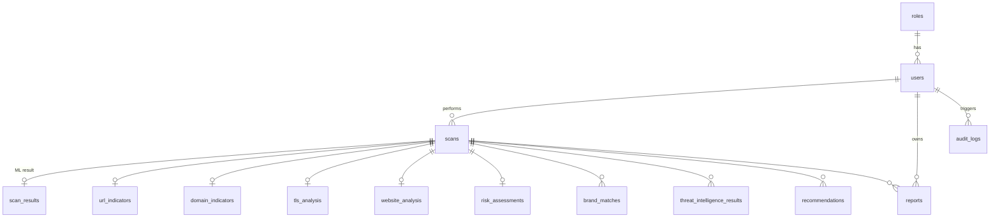

# Database design (PostgreSQL 12+)

- 1:1 analysis tables use `scan_id` as primary key, so a scan can never have two of them. 1:N tables have their own id plus `unique(scan_id, …)` where it makes sense.
- Deleting a scan cascades to every child row; deleting a user cascades to their scans and reports. Audit logs keep their rows (`user_id` becomes NULL) and the `user_email` snapshot.
- `risk_assessments.level` / `threat_level` are generated from `score` and cannot disagree with it.
- `users.password_hash` has a CHECK that only accepts a bcrypt hash.
- `scan_summaries` is a read view joining scans, users, risk and ML result; lists and dashboards use it.
- Auth security (migration 004): `users.token_version` (bump = sign out everywhere), `failed_login_attempts` / `locked_until` (account lockout), `revoked_tokens` (logout).
- Analysis engine (migration 005): `analysis_reports` keeps the engine's full JSON per scan; `scans.error_message` explains failures; `domain_indicators.dns_resolves` is nullable (unknown != does not resolve).
- Extra tables: `threat_feeds`, `threat_indicators` (admin blocklist), `attachment_analyses`, `schema_migrations`.
- Migrations live in `src/db/migrations`, are applied in order inside transactions, are checksummed (editing an applied file is an error), and run under an advisory lock.
